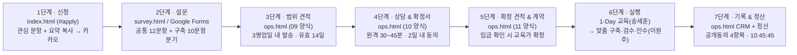

# 리드마스터 AX 퍼널 아키텍처 & 운영 가이드

`리드마스터 AX 퍼널 기획 (2026-11)` 11개 문서를 기반으로 구축된 **7단계 전환 퍼널 + 운영 워크스페이스**입니다.  
정적 파일만으로 동작(서버·빌드 불필요)하며, 구글 폼·구글 시트 연동용 Apps Script도 함께 포함되어 있습니다.

---

## 1. 7단계 퍼널 흐름



---

## 2. 파일 구성

| 파일 | 퍼널 단계 | 역할 |
|---|---|---|
| `index.html` | 1단계 · 신청 | 고객용 랜딩 (프로그램 사다리 · 통증/아침저녁 대비 · 1-Day 패키지 · 맞춤 구축 섹션 · 공개 장부 · 원칙 · FAQ · 2단계 진단 폼 · 모바일 고정 CTA) |
| `survey.html` | 2단계 · 설문 | 섹션 분기형 사전 설문 (공통 12문항 + 관심=`맞춤 구축`/`둘 다`일 때 2부 구축 10문항 자동 확장) |
| `ops.html` | 3~7단계 · 운영 | 송세훈·이원주 내부 워크스페이스 (40열 CRM + 빨강/노랑 기한 경고 · 09/10/11 문서 생성기 & A4 PDF 인쇄 · 10:45:45 정산 계산기 · 미정 항목 10건 & 설정) |
| `funnel-store.js` | 공통 | `localStorage` 통합 상태 관리 (`readmaster-ax-apply`, CRM, 설문, 정산, 미정 항목, CSV/JSON 내보내기) |
| `styles.css` | 공통 | 접근성(포커스 링, `prefers-reduced-motion`) 및 A4 인쇄(`@media print`) 대응 스타일 |
| `apps-script/funnel_automation.gs` | 구글 워크스페이스 | 섹션 분기 구글폼 1-Click 생성(`createAxSurveyForm`) 및 CRM 시트 조건부 서식(`setupCrmFormatting`) |

---

## 3. 바로 실행 및 배포 방법

### 로컬 실행
- `index.html`을 브라우저로 바로 열거나, 정적 서버로 확인합니다:
  ```bash
  python -m http.server 8080
  # 랜딩: http://localhost:8080/index.html
  # 설문: http://localhost:8080/survey.html
  # 운영: http://localhost:8080/ops.html
  ```

### 서버 폼 수집 연동 (선택)
- 기본은 브라우저 `localStorage` 저장 + 카카오 오픈채팅 요약 복사입니다.
- Formspree / Getform / Apps Script 웹앱으로 전송하려면 `index.html`의 `</body>` 직전에 아래 한 줄을 추가합니다:
  ```html
  <script>window.AX_FORM_ENDPOINT = 'https://your-endpoint.example/f/xxxx';</script>
  ```

### Google Forms & Sheets 연동
1. `script.google.com`에 `apps-script/funnel_automation.gs`를 붙여넣고 `createAxSurveyForm()`을 1회 실행하면 02 설문 문항 초안 그대로 섹션 분기 구글폼이 생성됩니다.
2. CRM 구글 시트에서 `확장 프로그램 > Apps Script`에 붙여넣고 `setupCrmFormatting()`을 실행하면 빨강(기한 초과) / 노랑(설문 미회신 3일 · 견적 만료 3일 전) 조건부 서식이 적용됩니다.

---

## 4. 배포 전 반드시 확정할 항목 (05 미정 체크리스트)

1. **`ops.html` → `4. 미정 항목 & 기본 설정`** 탭에서 아래 값을 먼저 확정·입력하세요:
   - 카카오 오픈채팅 실제 URL (`REPLACE_WITH_YOUR_OPENCHAT` 교체)
   - **#1** 1-Day를 구축의 필수 선행으로 둘지
   - **#3** 계약 주체(사업자 명의) 및 부가세 포함/별도 여부
   - **#5** 구축 견적 최소 금액 및 설문 예산대 구간
   - **#7** 지급 비율(계약금/잔금), 하자 보수 기간, 유지 포함 시간, 확정 견적서 유효기간
   - **#8** 설문 개인정보 보관 기간
2. **보안 주의**: 고객 실명·받은 금액·계좌번호는 공개 GitHub Pages 저장소에 커밋하지 마세요. `ops.html`은 내부 운영 전용이므로 공개 배포 시 `index.html`·`survey.html`·`styles.css`·`funnel-store.js`만 게시하거나 `ops.html`은 로컬/비공개 경로에서 사용하세요.
